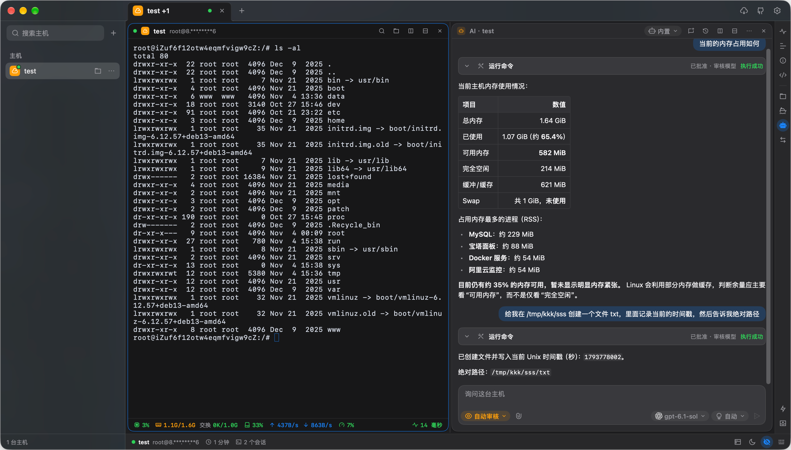
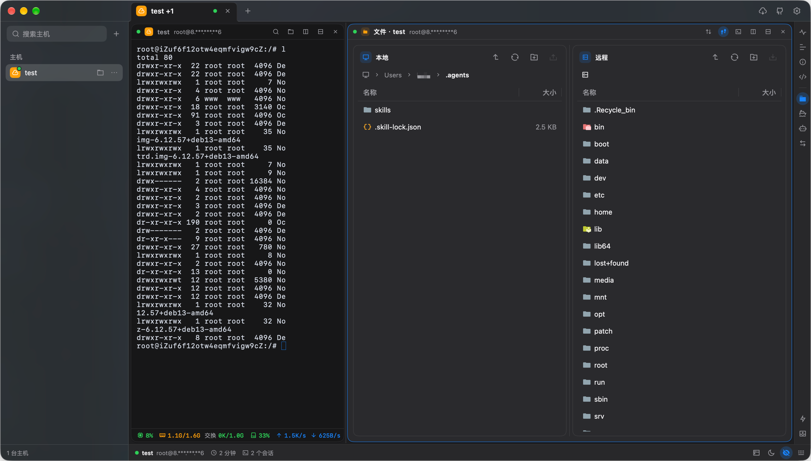
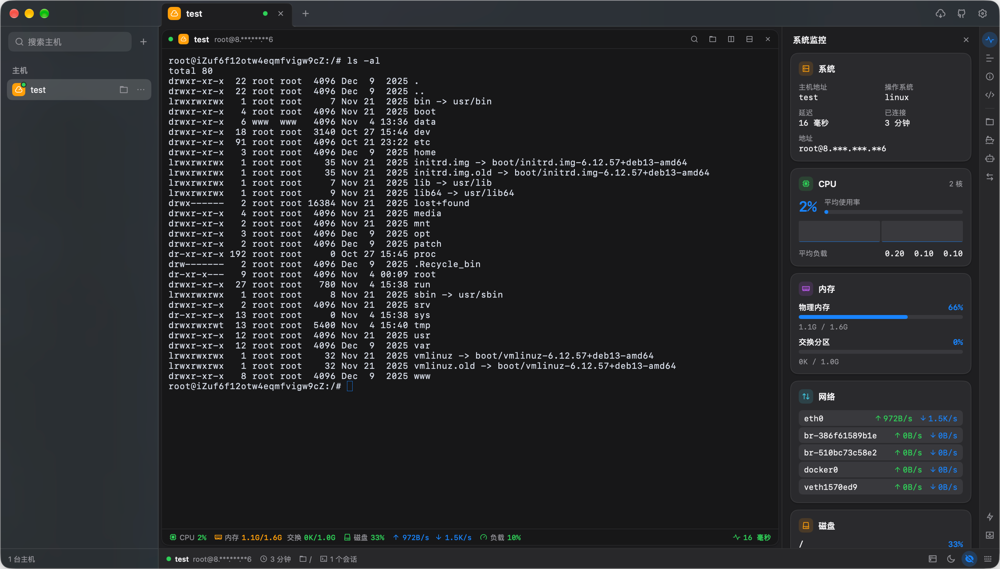
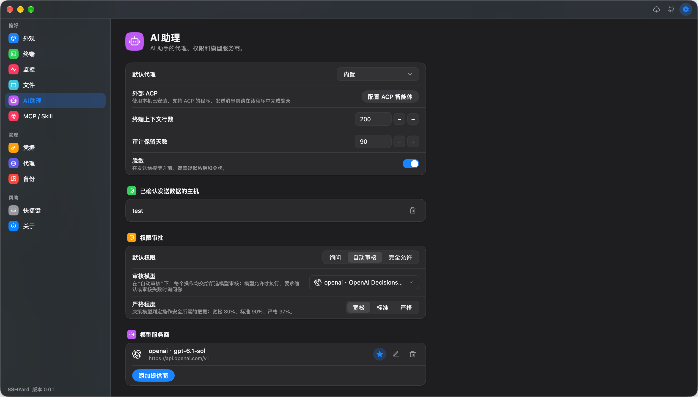

<p align="left"><a href="README.md">English</a> · <a href="README_ZH.md">简体中文</a> · <a href="README_ZH_TW.md">繁體中文</a> · <a href="README_KO.md">한국어</a> · <a href="README_JA.md"><strong>日本語</strong></a></p>

<p align="center">
  
</p>

<h1 align="center">SSHYard</h1>

SSHYardは、macOS、Windows、Linux向けのネイティブデスクトップSSH / SFTPクライアントです。ターミナル、ファイル管理、AIアシスタントを1つのアプリにまとめています。

## スクリーンショット

<table>
  <tr>
    <td width="50%" align="center">
      <br>
      ターミナルとAIアシスタント
    </td>
    <td width="50%" align="center">
      <br>
      SFTPファイルマネージャー
    </td>
  </tr>
  <tr>
    <td width="50%" align="center">
      <br>
      システムモニター
    </td>
    <td width="50%" align="center">
      <br>
      AIアシスタントの設定
    </td>
  </tr>
</table>

## 機能

- **ターミナル**
  - タブ、ペイン分割、ターミナル内検索
  - トゥルーカラー、全角文字、入力メソッドに対応し、tmux、vim、htopでマウス操作が可能
  - 同じホストのペイン間で接続を共有し、自動再接続にも対応

- **ファイル管理**
  - ターミナルと並べて使えるSFTP、ディレクトリ追従、内蔵エディター
  - ドラッグ＆ドロップとフォルダー転送に対応
  - 一時停止、再開、再試行ができる転送キュー

- **AIアシスタント**
  - ホストごとの専用アシスタントからコマンド実行やファイル編集が可能
  - AIプロバイダーへの接続、または外部ACPエージェントの利用
  - 「確認」「審査」「フルアクセス」の各モードと、設定可能なAI審査

- **エージェント連携**
  - 公開API、MCP、スキル経由でローカルAIエージェントを接続
  - 保存済み認証情報を公開せずに、ホスト一覧の取得、接続、コマンド実行が可能
  - Claude CodeとCodex向けのスキルをワンクリックで設定、エージェントアクセスは初期状態で無効

- **ホストと認証情報**
  - SSH設定からのインポート、または`user@host:port`でのクイック接続
  - パスワード、OpenSSH / PEM / PuTTY鍵、SSHエージェントに対応
  - ローカルでの認証情報の暗号化保存、鍵生成、公開鍵のインストール

- **バックアップと復元**
  - ホスト、認証情報、スニペット、設定をパスワードで暗号化してバックアップし、別のデバイスで復元
  - ローカル、WebDAV、S3互換ストレージ、シークレットGitHub Gistに保存
  - 手動・定期バックアップと、保持数の設定

- **ネットワーク**
  - 多段の踏み台ホストとHTTP / SOCKS5プロキシ
  - ローカル、リモート、動的ポート転送

- **日々の使いやすさ**
  - サーバーのメトリクスをひと目で確認
  - ライト・ダークテーマ、英語、簡体字中国語、繁体字中国語、韓国語、日本語に対応

## 開発

[mygo](https://github.com/egoist/mygo)を使用しています。Go 1.27.3が必要です（`GOTOOLCHAIN`でダウンロード可能）。cgoは不要です。

```sh
# 実行
go run .

# 開発用アプリを実行、macOSでは「Apple Development」の署名IDを推奨
# 安定した署名によりキーチェーンの確認を減らせる場合があります
# 自己署名では再ビルド後のアクセスを保証できず、macOSが再度認証を求めることもあります
scripts/run-dev-app.sh

# データを別のディレクトリに保存
SSHYARD_DATA_DIR=/tmp/demo go run .

# テスト用のローカルSSHサーバー（macOS / Linux）
go run ./cmd/devsshd -addr 127.0.0.1:2222 -user demo -password demo -root /tmp/remote

# テスト用のローカルHTTP / SOCKSプロキシ
go run ./cmd/devproxy -addr 127.0.0.1:3128

# テストとチェック
go test -race -count=1 ./...
go vet ./...
gofmt -l .

# locales/*.jsonの編集後に言語カタログを再生成
GOFLAGS=-mod=mod go run github.com/egoist/mygo/cmd/mygo generate

# dist/にパッケージを作成
go tool mygo build -platform linux/amd64,linux/arm64,windows/amd64,windows/arm64,darwin/arm64,darwin/amd64 -o dist
```

devsshdで試すには、ホスト`127.0.0.1`、ポート`2222`、ユーザー`demo`、パスワード`demo`を追加してください。

コントリビューター向けのルールは[AGENTS.md](AGENTS.md)をご覧ください。

## コミュニティサポート

- [LinuxDO](https://linux.do)

## ライセンス

SSHYardは[GNU Affero General Public License v3.0](LICENSE)のもとで提供されています。
