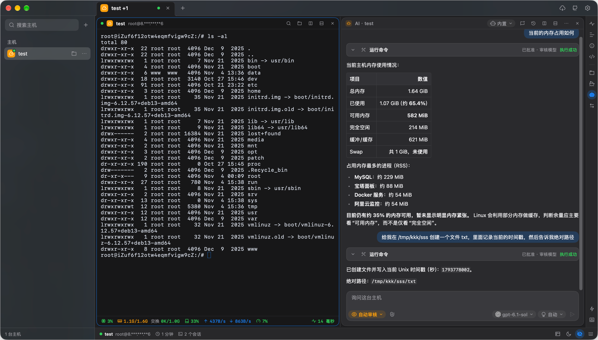
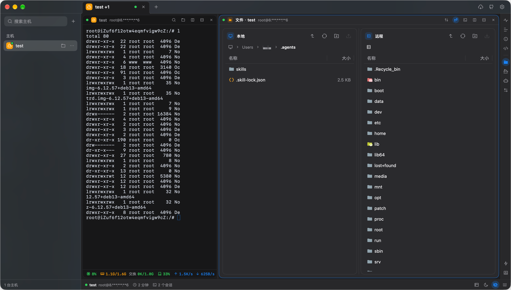
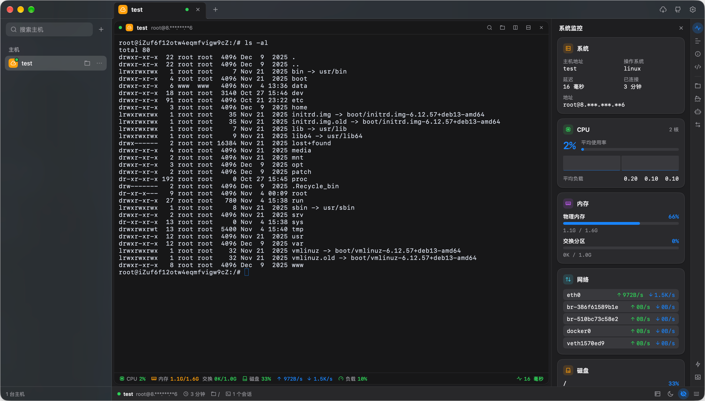
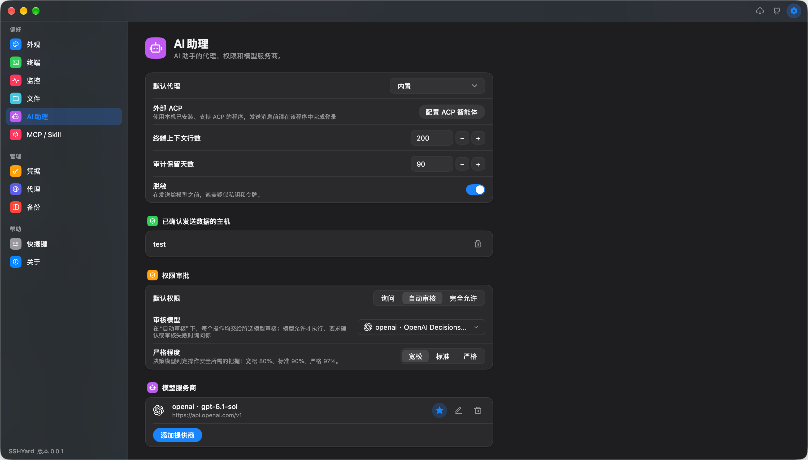

<p align="left"><a href="README.md">English</a> · <strong>中文</strong></p>

<p align="center">
  
</p>

<h1 align="center">SSHYard</h1>

SSHYard 是一款原生桌面 SSH / SFTP 客户端，支持 macOS、Windows 和 Linux，将终端、文件管理与 AI 助手集于一体。

## 截图

<table>
  <tr>
    <td width="50%" align="center">
      <br>
      终端与 AI 助手
    </td>
    <td width="50%" align="center">
      <br>
      SFTP 文件管理
    </td>
  </tr>
  <tr>
    <td width="50%" align="center">
      <br>
      系统监控
    </td>
    <td width="50%" align="center">
      <br>
      AI 助手设置
    </td>
  </tr>
</table>

## 功能

- **终端**
  - 多标签、分屏与终端搜索
  - 真彩色、宽字符、输入法，以及 tmux、vim、htop 鼠标操作
  - 同一主机的多个面板共享连接，断线自动重连

- **文件管理**
  - SFTP 与终端并排，支持跟随终端目录和内置编辑器
  - 支持文件拖放和文件夹传输
  - 传输队列支持暂停、续传和重试

- **AI 助手**
  - 每台主机独立的助手面板，支持执行命令、编辑文件
  - 接入 AI 服务商或使用外部 ACP 智能体
  - 询问、审阅、完全访问三种权限模式，可配置 AI 自动审核

- **智能体接入**
  - 通过开放 API、MCP 和 Skill 接入本机 AI 智能体
  - 查看主机、建立连接和执行命令，无需向智能体暴露已保存的凭据
  - 支持为 Claude Code、Codex 一键配置 Skill，接入功能默认关闭

- **主机与凭据**
  - 从 SSH 配置导入，或通过 `user@host:port` 快速连接
  - 支持密码、OpenSSH / PEM / PuTTY 密钥和 SSH Agent
  - 凭据本地加密保存，支持生成密钥和安装公钥

- **备份与恢复**
  - 密码加密备份主机、凭据、快捷指令和设置，支持跨设备恢复
  - 保存到本地、WebDAV、S3 兼容存储或 GitHub 私密 Gist
  - 支持手动与定时备份，可设置保留份数

- **网络连接**
  - 多级跳板机与 HTTP / SOCKS5 代理
  - 本地、远程和动态端口转发

- **日常体验**
  - 服务器状态监控
  - 浅色与深色主题，英文与简体中文

## 开发

基于 [mygo](https://github.com/egoist/mygo) 构建，需要 Go 1.27.3（可借助 `GOTOOLCHAIN` 自动下载），不需要 cgo。

```sh
# 运行
go run .

# 运行开发版 app；macOS 上优先用 "Apple Development" 证书签名
# 稳定签名可减少钥匙串提示，自签名不能保证跨构建沿用授权
# macOS 仍可能要求重新授权
scripts/run-dev-app.sh

# 把数据放到单独的目录
SSHYARD_DATA_DIR=/tmp/demo go run .

# 本地测试用 SSH 服务器（macOS / Linux）
go run ./cmd/devsshd -addr 127.0.0.1:2222 -user demo -password demo -root /tmp/remote

# 本地测试用 HTTP / SOCKS 代理
go run ./cmd/devproxy -addr 127.0.0.1:3128

# 测试与检查
go test -race -count=1 ./...
go vet ./...
gofmt -l .

# 修改 locales/*.json 后重新生成多语言目录
GOFLAGS=-mod=mod go run github.com/egoist/mygo/cmd/mygo generate

# 打包到 dist/
go tool mygo build -platform linux/amd64,windows/amd64,darwin/arm64,darwin/amd64 -o dist
```

连接 devsshd 测试时，新建主机 `127.0.0.1`，端口 `2222`，用户 `demo`，密码 `demo`。

开发约定见 [AGENTS.md](AGENTS.md)。

## 社区支持

- [LinuxDO](https://linux.do)

## 开源协议

SSHYard 基于 [GNU Affero General Public License v3.0](LICENSE) 开源。
